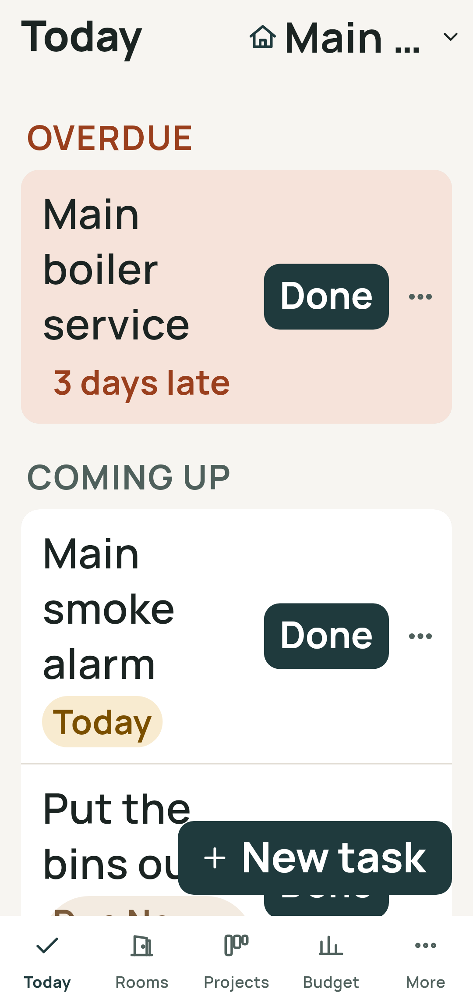
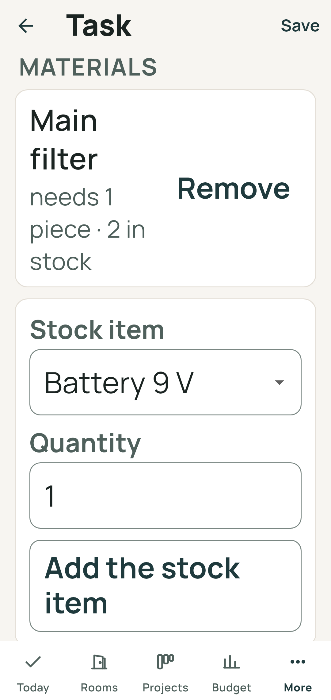

# Housecairn mobile

**Plan your home's maintenance and renovation work, room by room.**

[Housecairn](https://github.com/HouseCairn/housecairn) keeps the list of everything your house needs, from recurring upkeep
such as the smoke detector battery to projects such as repainting the living
room. For each job it knows the room, the date, the supplies and the planned
cost, and anyone in the household marks it done in one tap. It is free software
that you host yourself, works on its own, and connects to Home Assistant if you
use it.

This repository is the phone app, for iOS and Android: the same planning on the
phone, offline first. **It is in development and not published on the App Store
or Google Play yet** (see [Status](#status)).

  

Rendered by the app's screenshot test (`test/goldens/`), with test data, not on a
phone.

For example, on the phone:

- test the smoke detector every six months, without remembering the last time;
- clean the ventilation filter every three months;
- book the yearly boiler service;
- one app for several homes: a main home, a second home, a rented flat.

### One example: descaling the espresso machine

The example the [web application](https://github.com/HouseCairn/housecairn) follows in its
documentation, as it runs on the phone today:

1. A task, *Descaling*, every three months after the last time.
2. It belongs to the *Espresso machine* of the kitchen.
3. It uses one water filter, taken from the stock each time you tap **Done**.
4. The stock goes down, and the filter is marked low before you run out.
5. The filter at 7.90 is counted in the estimate of each time, and the **Upkeep** tab of
   the **Budget** lists the task with its **Cost a year**, 31.60, four times the estimate.

The image is rendered by the app's screenshot test (`test/goldens/`), with test data.

 

## What it is

- **Standalone.** The data lives on the phone, in SQLite. The app works fully with no
  network, no account and no server. It does not need a Housecairn instance.
- **Free.** Every feature that runs on one phone is free.
- **Several homes.** A main home, a second home, a rented flat: one app, one switch.
- **Family sync, paid by subscription.** Phones of one household share all their homes, photos
  included, through a relay that stores and forwards **end-to-end encrypted** data it cannot
  read. The hosted relay will run in the European Union.
- **Open.** App and relay are open source. The hosted relay is sold; anyone can run their
  own relay, and point the app at it, at no cost.
- **One code base**, Flutter, for both platforms.
- **Documented protocol.** The sync protocol is versioned and written down so that another
  server, a Housecairn instance later, can play the relay.

Not in the first version: the Home Assistant integration, the connectors of the web
application (Paperless-ngx, Sure, Apprise), calendar feeds.

## Status

**In development, not published.** The app is not on the App Store or Google Play, and no
version is released; the first builds will be alpha. Merged so far, from the
[plan](docs/plan.md): the foundations (lot 1: the Flutter project for Android and iOS, the
app shell, English and French, the continuous integration with an Android APK and an
unsigned iOS build on every pull request), the data, the recurrence and several homes with
the Today, Task and Homes screens (lot 2a), the look of the web application (lot 2d), and
the rooms, items, contractors, task templates, photos and local reminders (lot 2b),
the stock with the materials of the tasks (lot 3a), and the projects, quotes, budget and
real cost (lot 3b). Family sync is still to come. How to build and
test: [CONTRIBUTING.md](CONTRIBUTING.md).

| Document | What it settles |
| --- | --- |
| [docs/spec.md](docs/spec.md) | Scope of v1: what is taken from the Housecairn model, simplified or left out; screens; reminders; encrypted export |
| [docs/adr/](docs/adr/) | Decisions: stack and packages, local storage, sync, encryption, relay, subscription, license, several homes in one family space |
| [docs/protocol.md](docs/protocol.md) | Sync and relay protocol, precise enough for another server to implement |
| [docs/threat-model.md](docs/threat-model.md) | What is protected, from whom, and what is not |
| [docs/plan.md](docs/plan.md) | Lots 1 to 9, with acceptance criteria, and the questions still open |

## Related

- [HouseCairn/housecairn](https://github.com/HouseCairn/housecairn): the self-hosted web
  application, whose data model this app follows.
- `HouseCairn/housecairn-relay`: the relay, in its own repository from lot 6 of the plan.
- Documentation of the web application: <https://docs.housecairn.app>.

## The Housecairn repositories

- [housecairn](https://github.com/HouseCairn/housecairn): the web application, to install first.
- [home-assistant-addons](https://github.com/HouseCairn/home-assistant-addons): Housecairn as a Home Assistant app (add-on).
- [home-assistant-housecairn](https://github.com/HouseCairn/home-assistant-housecairn): the Home Assistant integration (HACS).
- [housecairn-mobile](https://github.com/HouseCairn/housecairn-mobile): the phone app for iOS and Android, in development, not on the stores yet (this repository).
- [website](https://github.com/HouseCairn/website): the site <https://housecairn.app>.

Website: <https://housecairn.app>. Documentation, in English and French:
<https://docs.housecairn.app>.

## How it is made

Housecairn is developed with an AI coding agent, under human review. Each pull request is
reviewed by a second AI model, then read and merged by the human maintainer, who is
responsible for what enters the repository. Every pull request states which AI tool and model
were used.

## Contributing

See [CONTRIBUTING.md](CONTRIBUTING.md): the CLA of the project and a `Signed-off-by` on every
commit.

## License

Housecairn mobile is free software under the GNU Affero General Public License, version 3 only
(`AGPL-3.0-only`), as the web application: see [LICENSE](LICENSE), and [NOTICE](NOTICE) for the
copyright and the additional terms (author attribution, trademark) under section 7
([ADR 0007](docs/adr/0007-license.md)).
